  

  
  

  <a href="#about">About</a> ·
  <a href="#the-organizations">Organizations</a> ·
  <a href="#the-os-stack">The OS stack</a> ·
  <a href="#also-here">Also here</a>

## About

**Sorabbyngo** is a deep technology lab building for everyone, since 2024.

Our main project is an **agentic operating system**: an independent Linux system where AI is infrastructure rather than a chatbot. You can speak to it, type to it, or ignore the AI entirely, and every path ends at the same mediated, observable and undoable action layer.

> **Models come and go. The path from intent to effect stays yours.**

The work is open source and still early. Most repositories are **pre-alpha**, and each README says honestly what exists today and what is still design.

## The organizations

Sorabbyngo is split into focused GitHub organizations so each area can grow on its own.

| Organization | What lives there |
| --- | --- |
| [**sorabbyngo-os**](https://github.com/sorabbyngo-os) | The operating system: kernel, desktop, AI runtime, filesystem, mesh network, security and safety |
| [**sorabyte-cloud**](https://github.com/sorabyte-cloud) | Cloud: inference, SDK, agents-as-a-service, digital twin and edge |
| [**sorabbyngo-vector**](https://github.com/sorabbyngo-vector) | Vector store and semantic search |
| [**byngo-search**](https://github.com/byngo-search) | The search layer |
| [**sorabbyngo-people**](https://github.com/sorabbyngo-people) | Team, culture and hiring |
| [**novela-health**](https://github.com/novela-health) | The healthcare vertical |

## The OS stack

Sorabbyngo OS is built on a Linux 6.19 kernel with an immutable Fedora bootc base. The parts fit together like this:

| Layer | Project | Role |
| --- | --- | --- |
| Desktop | [**vanta**](https://github.com/sorabbyngo-os/vanta) | The spatial Wayland desktop, written in Rust |
| Voice | [**chameha**](https://github.com/sorabbyngo-os/chameha) | Voice and personality, built to run on-device |
| Intelligence | [**aion**](https://github.com/sorabbyngo-os/aion) | The AI runtime that plans, routes and mediates every action |
| Safety | [**cml**](https://github.com/sorabbyngo-os/cml) | The Cognitive Mediation Layer for safety, alignment and privacy |
| World model | [**objectspace**](https://github.com/sorabbyngo-os/objectspace) | The objects and spaces that Vanta renders |
| Network | [**byngonet**](https://github.com/sorabbyngo-os/byngonet) | A mesh network protocol with post-quantum security |
| Security | [**sentinel**](https://github.com/sorabbyngo-os/sentinel) | The security, trust and threat-intelligence engine |
| Base | [**fedora-base**](https://github.com/sorabbyngo-os/fedora-base) | The image definitions and inherited system components |

Earlier prototypes, such as the 8-agent swarm in `byngox` and the first Wayland shell, have been replaced by AION and Vanta. They stay in the organization as history.

See the full list on the [**sorabbyngo-os**](https://github.com/sorabbyngo-os) page.

## Also here

| Repository | What it is |
| --- | --- |
| [**citadel-sec**](https://github.com/sorabbyngo/citadel-sec) | Cybersecurity defense, intrusion detection and anti-malware |

## Get involved

Ideas, issues and pull requests are welcome in any of the organizations above. Please open an issue to talk through anything large first. Hiring and team information lives in [**sorabbyngo-people**](https://github.com/sorabbyngo-people).

  <b>Sorabbyngo</b> · <i>The Rhythm of Digital Life</i> 
  Built for everyone.

